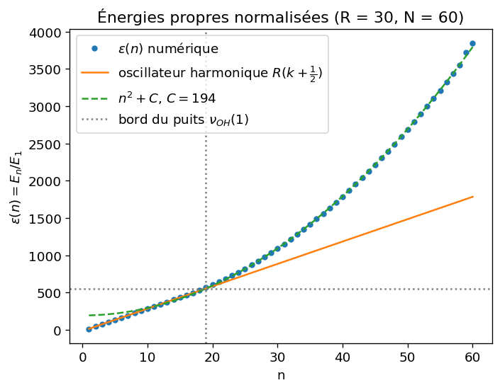
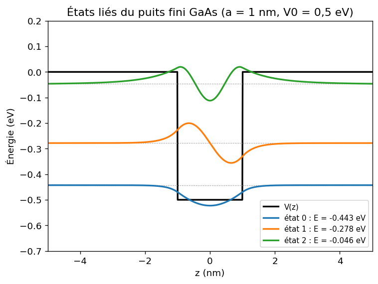

# Oscillateur harmonique et puits quantique fini

> **EN —** Finite-basis diagonalisation of the Schrödinger equation: (I) harmonic oscillator confined in an infinite well (Marsiglio's method), with energies and eigenfunctions compared to the analytical solutions; (II) bound states of a GaAs/AlGaAs quantum well, checked against the graphical quantisation conditions.

*TP numérique de physique quantique (tronc commun), ESPCI Paris - PSL, novembre-décembre 2025.*

## Partie I : oscillateur harmonique dans un puits infini

On place un potentiel harmonique au centre d'un puits infini de largeur *a*. On développe la fonction d'onde sur les états propres du puits infini φₙ(x) = √2 sin(nπx), puis on diagonalise la matrice de l'hamiltonien normalisé :

hₙₘ = n² δₙₘ + 2 ∫₀¹ sin(nπx) ν_OH(x) sin(mπx) dx, avec ν_OH(x) = (π²/4) R² (x − ½)² et R = ħω / E₁.

**Résultats (R = 30, N = 60)**
- Les éléments de matrice calculés par intégration numérique coïncident, à 10⁻¹² près, avec les expressions analytiques démontrées dans le rapport. Un terme non diagonal sur deux est nul, pour des raisons de parité par rapport à x = ½.
- Les premières énergies propres valent 15, 45, 75, 105, 135, soit exactement R(k + ½) : c'est le spectre de l'oscillateur harmonique.
- Pour n grand, les énergies suivent n² + C avec C ≈ 194. L'estimation par les termes diagonaux donne π²R²/48 ≈ 185. C'est le régime « puits infini ».
- La transition entre les deux régimes a lieu vers n₀ = 19, quand l'énergie dépasse la valeur du potentiel au bord du puits, ν_OH(1) = π²R²/16 ≈ 555.
- Les fonctions propres Ψ₀, Ψ₁ et Ψ₂ convergent vers les solutions analytiques dès N = 15.

## Partie II : puits quantique fini dans une hétérostructure GaAs/AlGaAs

Le puits a une largeur 2a = 2 nm et une profondeur V₀ = 0,5 eV. Il est tronqué par un puits infini de largeur 2b = 10 nm, et la base comporte N = 150 états.

**Résultats**
- On trouve 3 états liés, d'énergies −0,443 eV, −0,278 eV et −0,046 eV.
- Les conditions de quantification du puits fini, |cos(qa)| = q/q₀ pour les états pairs et |sin(qa)| = q/q₀ pour les états impairs, sont vérifiées au millième près.

## Fichiers

| Fichier | Contenu |
|---|---|
| `oscillateur_harmonique.py` | Partie I : construction et diagonalisation de H, énergies, fonctions propres |
| `puits_fini.py` | Partie II : états liés du puits fini et vérification des conditions de quantification |
| `rapport/` | Rapport rendu, avec les démonstrations analytiques |

## Note

Le code a été revu et restructuré après le rendu. Voici ce qui diffère de l'annexe du rapport :
- la comparaison utilise l'expression exacte de l'oscillateur harmonique, R(k + ½) ;
- les fonctions propres sont calculées avec la bonne correspondance entre R et N ;
- la masse de l'électron vient de `scipy.constants`.

Les énergies du puits fini diffèrent donc légèrement de celles du rapport, de l'ordre de 0,005 eV au plus.

**Référence :** F. Marsiglio, *The harmonic oscillator in quantum mechanics: A third way*, Am. J. Phys. **77**, 253 (2009).
