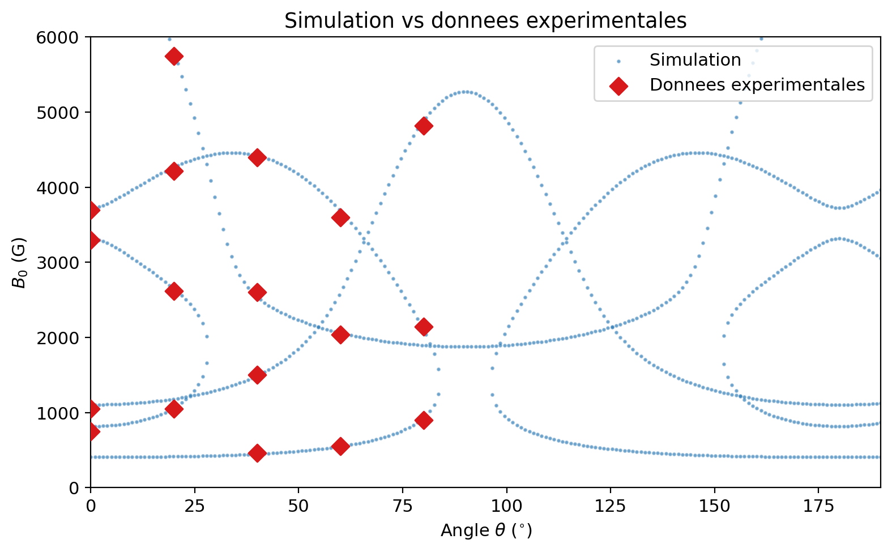
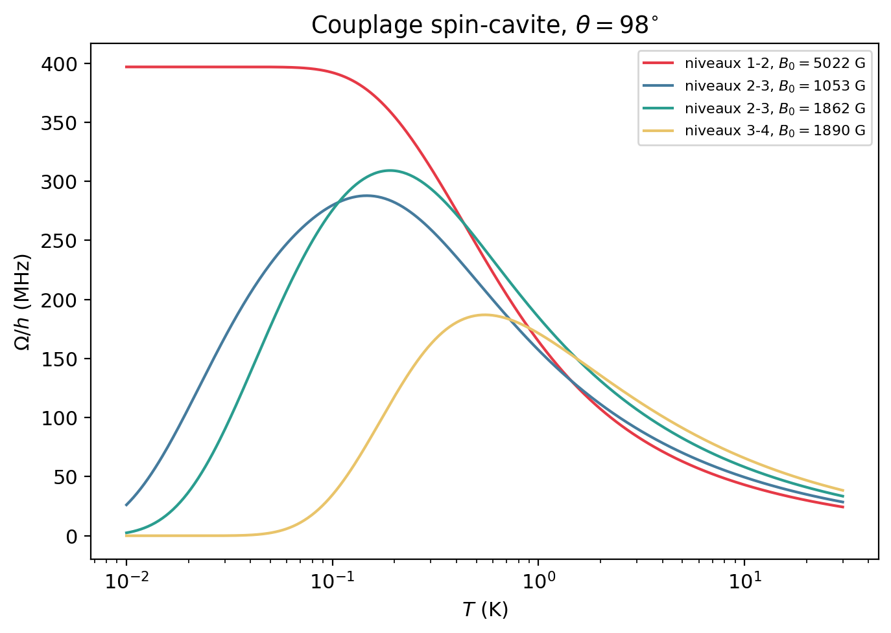

# Résonance paramagnétique électronique dans le rubis

> **EN —** Numerical model of the EPR spectrum of Cr³⁺ ions (S = 3/2) in ruby: diagonalisation of the crystal-field + Zeeman spin Hamiltonian, resonance fields for a 9.19 GHz cavity versus field angle (agreement with experimental data within 3%), and temperature dependence of the collective spin-cavity coupling through Boltzmann populations.

*TP numérique de physique quantique (option), ESPCI Paris - PSL, mai 2026.*

## Modèle

Dans le rubis (Al₂O₃ dopé à 0,1 % en Cr³⁺), chaque ion Cr³⁺ porte un spin S = 3/2. Son hamiltonien, exprimé en unités de fréquence, s'écrit :

H/h = −D (S_z² − S²/3) + ν_Z (S_z cos θ + S_x sin θ), avec ν_Z = g μ_B B₀ / h.

Les paramètres sont D = 5,73 GHz (champ cristallin) et g = 1,98. θ est l'angle entre le champ B₀ et l'axe c du cristal.

On diagonalise la matrice 4×4 pour B₀ entre 0 et 6000 G et θ entre 0° et 190°. On détecte ensuite les champs pour lesquels |Eᵢ − Eⱼ| = h f_cav, avec f_cav = 9,19 GHz.

## Résultats

- **Niveaux d'énergie :** à champ nul, on obtient deux doublets séparés de 2D = 11,46 GHz. À 6000 G, l'effet Zeeman domine et mélange fortement les états |m_s⟩.
- **Carte des résonances (θ, B₀) :** à θ = 40°, les champs simulés sont 449, 1492, 2539 et 4423 G, pour 460, 1500, 2600 et 4400 G mesurés. L'écart est inférieur à 3 %.
- **Couplage spin-cavité Ω(T) :** il est calculé à partir de la différence de populations de Boltzmann entre les niveaux de chaque transition, pour environ 4,7 × 10¹⁶ ions. La transition fondamentale a un couplage qui décroît avec la température, tandis que les transitions entre états excités passent par un maximum à une température intermédiaire. Le couplage atteint environ 400 MHz à θ = 98°, contre environ 175 MHz à θ = 36°.

  
  

## Fichiers

| Fichier | Contenu |
|---|---|
| `rpe_rubis.py` | Hamiltonien de spin, niveaux, recherche des résonances, comparaison expérimentale, calcul de Ω(T) |
| `figures/` | Figures générées par le script |
| `rapport/` | Rapport rendu, rédigé en LaTeX |

Les données expérimentales sont les mesures de la promotion 2018, fournies avec l'énoncé.
