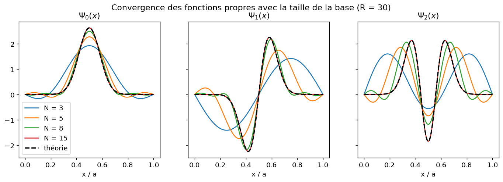
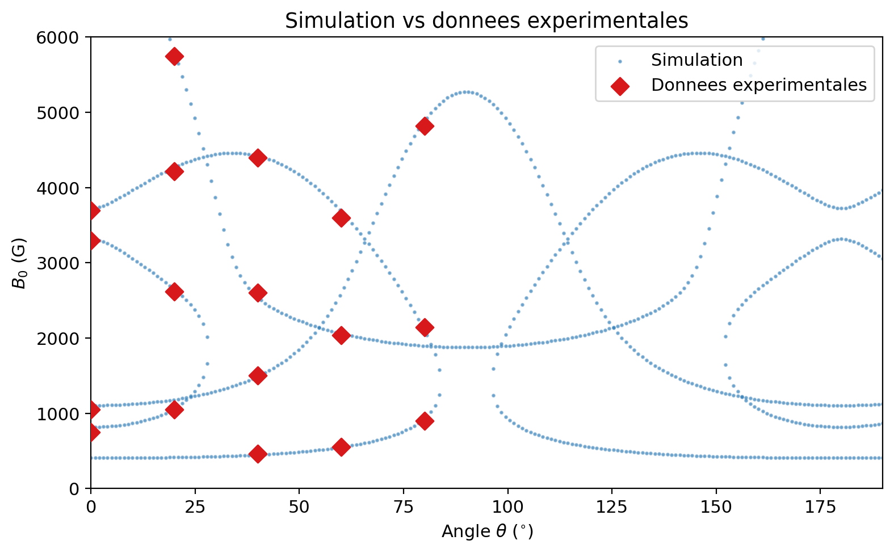

# Physique quantique numérique

> **EN —** Numerical quantum mechanics projects carried out at ESPCI Paris - PSL (2025-2026): Hamiltonian diagonalisation in a finite basis to solve the quantum harmonic oscillator and a semiconductor quantum well, and a spin-Hamiltonian model of electron paramagnetic resonance (EPR) in ruby, validated against experimental data. Python · NumPy · SciPy · Matplotlib.

Deux travaux de résolution numérique de problèmes de physique quantique réalisés dans le cadre du cours de physique quantique de l'**ESPCI Paris - PSL**. Chaque projet compare les résultats numériques à des solutions analytiques ou à des mesures expérimentales.

| Projet | Physique | Méthodes | Résultat clé |
|---|---|---|---|
| [01 · Oscillateur harmonique et puits fini](01-oscillateur-harmonique-et-puits-fini) | Oscillateur harmonique quantique, puits quantique fini GaAs/AlGaAs | Développement sur une base finie, diagonalisation de l'hamiltonien, intégration numérique | Énergies de l'oscillateur retrouvées à 10⁻⁸ près ; 3 états liés dans le puits fini, conformes aux conditions de quantification |
| [02 · RPE dans le rubis](02-rpe-rubis) | Spin S = 3/2 du Cr³⁺, champ cristallin, effet Zeeman, couplage spin-cavité | Diagonalisation d'un hamiltonien de spin, recherche de résonances, statistique de Boltzmann | Champs de résonance à moins de 3 % des mesures expérimentales |

<p align="center">
  
</p>
<p align="center">
  
</p>

## Lancer les scripts

```bash
pip install -r requirements.txt
python 01-oscillateur-harmonique-et-puits-fini/oscillateur_harmonique.py
python 01-oscillateur-harmonique-et-puits-fini/puits_fini.py
python 02-rpe-rubis/rpe_rubis.py
```

Chaque script affiche ses résultats numériques dans le terminal et régénère ses figures dans le dossier `figures/` du projet.

## Structure

```
.
├── 01-oscillateur-harmonique-et-puits-fini/
│   ├── oscillateur_harmonique.py   # partie I : oscillateur harmonique tronqué
│   ├── puits_fini.py               # partie II : puits quantique fini
│   ├── figures/
│   └── rapport/                    # rapport rendu (PDF)
└── 02-rpe-rubis/
    ├── rpe_rubis.py
    ├── figures/
    └── rapport/                    # rapport rendu (PDF, rédigé en LaTeX)
```

## Auteur

**Maxime Rimbaud** — élève ingénieur à l'ESPCI Paris - PSL · [LinkedIn](https://www.linkedin.com/in/maxime-rimbaud)

Les énoncés des TP appartiennent à l'ESPCI et ne sont pas reproduits ici.
